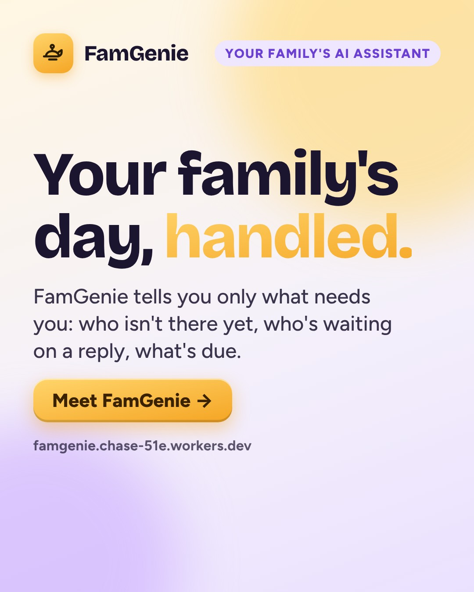
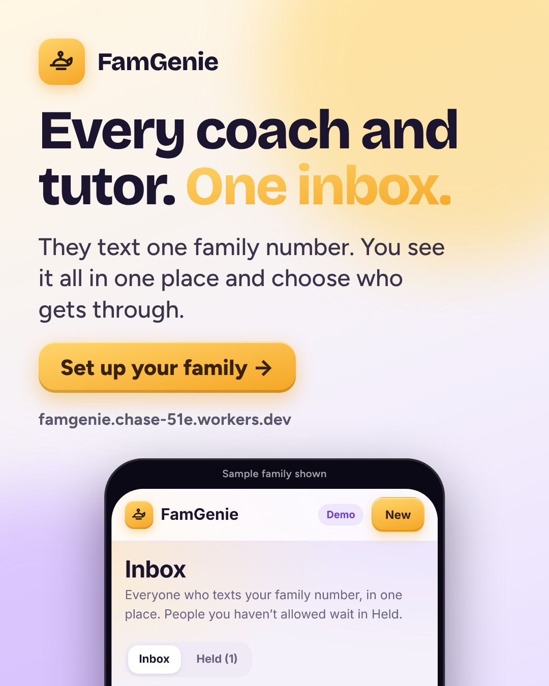
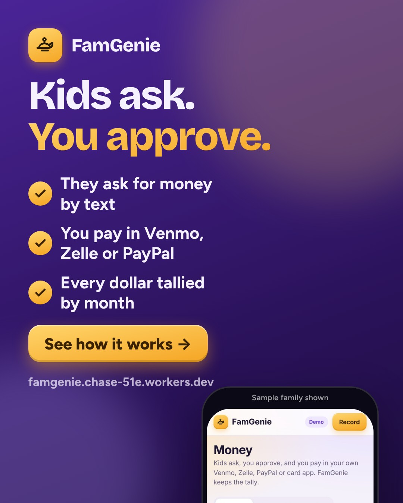
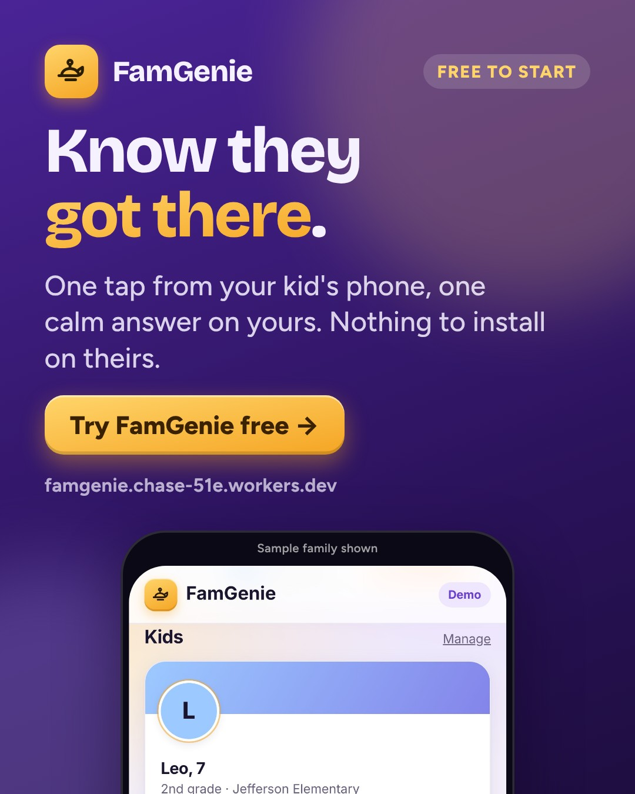
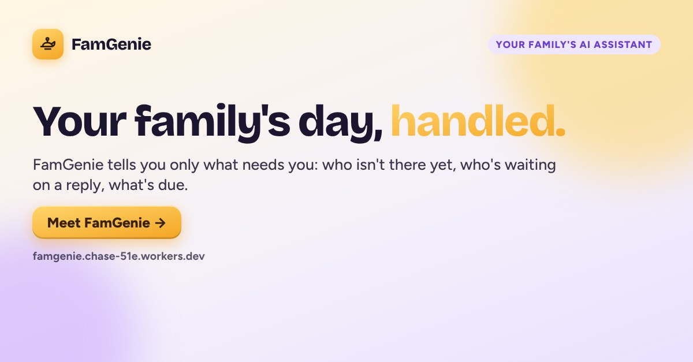

# FamGenie · week of 2026-11-09 · Meet FamGenie

**Approve by merging this pull request.** Facebook and Instagram posts then go out at their times. Everything else is a ready-to-paste draft.
To change something, edit `marketing/campaigns/2026-11-09.json` and rebuild, or set `"skip": true` on a post. Delete a post to drop it.

**Goal:** First 50 parent sign-ups; learn which message (check-ins, one inbox, or kids' money) gets the most clicks.
**Why this angle:** Launch week. Each ad leads with one real feature so the tracked links show which pain parents care about most. Holiday-season schedules are filling up, so the 'who's driving' moment is timely.

## facebook · Mon, Nov 9, 7:30 PM · auto after approval



```text
Meet FamGenie: an AI assistant for busy parents.

It keeps an eye on the things that slip through the cracks: did they get to practice, which coach texted, who's asking you for money, and what's on the school calendar this week. It only speaks up when something needs you.

Free to start. https://famgenie.chase-51e.workers.dev/?utm_source=facebook&utm_medium=social&utm_campaign=2026-11-09-meet-famgenie&utm_content=fb-launch
```

_Posts automatically at the time shown after this is approved (merged)._

## facebook · Wed, Nov 11, 12:15 PM · auto after approval



```text
Three kids, two schools, a tutor, a coach and a parents' group chat. Sound familiar?

With FamGenie they all text one family number, and you see every message in one place. Anyone you haven't approved waits quietly instead of buzzing your phone.

https://famgenie.chase-51e.workers.dev/?utm_source=facebook&utm_medium=social&utm_campaign=2026-11-09-meet-famgenie&utm_content=fb-inbox
```

_Posts automatically at the time shown after this is approved (merged)._

## facebook · Fri, Nov 13, 7:00 PM · auto after approval



```text
"Mom, I need $40 for the tutor." Now it's one text.

Your kid asks, you approve, and you pay in your own Venmo, Zelle or PayPal. FamGenie never touches the money; it keeps the tally so you can see what each kid spent this month.

https://famgenie.chase-51e.workers.dev/?utm_source=facebook&utm_medium=social&utm_campaign=2026-11-09-meet-famgenie&utm_content=fb-money
```

_Posts automatically at the time shown after this is approved (merged)._

## instagram · Tue, Nov 10, 7:30 PM · auto after approval



```text
The 4:40pm question every parent knows: did they make it to practice?

FamGenie sends your kid a one-tap check-in. They share their location once, only when they tap, and you get a calm answer. No tracking app on their phone.

Free to start. Link in bio.

#parenting #momlife #dadlife #busyparents #familyorganization
```

_Posts automatically at the time shown after this is approved (merged)._

## instagram · Thu, Nov 12, 8:00 PM · auto after approval


```text
Coach, tutor, teacher, the room parents' chat... one inbox.

Everyone texts one family number and FamGenie sorts it for you. Link in bio.

#parenting #schoollife #momlife #organizedmom
```

_Posts automatically at the time shown after this is approved (merged)._

## instagram · Sat, Nov 14, 10:00 AM · auto after approval


```text
Teaching kids about money starts with seeing where it goes.

Kids ask by text, you approve, you pay in your own app, and FamGenie keeps the monthly tally per kid. Link in bio.

#parenting #moneytips #teensandmoney #momlife
```

_Posts automatically at the time shown after this is approved (merged)._

## linkedin · Tue, Nov 10, 8:30 AM · post by hand



```text
I've been building FamGenie, an AI assistant for busy parents.

The problem: a family's day is spread across a location app, school emails, five group chats, a calendar nobody updates, and Venmo requests. Parents become the human router.

What FamGenie does:
- one-tap check-ins from kids (location shared once, only when they tap)
- one inbox for coaches, tutors, teachers and parent groups
- kids' money requests you approve, paid in your own apps
- a short daily brief of only what needs you

What I learned building it: the hard part isn't the AI, it's restraint. Rules decide what matters; the AI only words it.

It's free to start. If you're a parent, I'd love your honest feedback: https://famgenie.chase-51e.workers.dev/?utm_source=linkedin&utm_medium=community&utm_campaign=2026-11-09-meet-famgenie&utm_content=li-founder
```

_Post by hand from your profile or the company page: paste the text, attach the image._

## reddit · Wed, Nov 11, 11:00 AM · post by hand

**Where:** r/SideProject

**Title:** I built an AI assistant for busy parents: check-ins, one inbox for coaches/tutors, and kids' money requests

```text
I made FamGenie because our family's logistics lived in six different apps.

What it does:
- Sends a kid a one-time check-in link. They tap, it shares their location once. No background tracking, no app on their phone.
- Gives the family one number that coaches, tutors and teachers text. Everything lands in one inbox; unknown numbers wait in a held folder.
- Kids ask for money by text ("PAY 40 tutor"); you approve and pay in your own Venmo/Zelle; it tallies spending per kid.
- A daily brief that only lists what needs you.

Stack: Cloudflare Workers + D1, Twilio for texts, Claude for the brief and drafted replies. Plain JS, no framework.

I'd love blunt feedback, especially on what would make you trust an app like this with family info: https://famgenie.chase-51e.workers.dev/?utm_source=reddit&utm_medium=community&utm_campaign=2026-11-09-meet-famgenie&utm_content=rd-sideproject
```

_Post by hand. Read the subreddit rules first, post as yourself, reply to every comment, and don’t post the same thing to several subreddits._

## tiktok · Thu, Nov 12, 7:00 PM · post by hand

```text
POV: your family's whole day in one app. Check-ins, coach texts, kids' money requests. #parentsoftiktok #momtok #dadtok #familyorganization
```

**Script:**

1. 0-2s: "Did they make it to practice?" on screen over the FamGenie home (hook)
2. 2-6s: scroll the daily brief: late check-in, tutor waiting, money request
3. 6-10s: tap Money, then Approve & pay: Venmo opens with the amount filled in
4. 10-14s: end card: Free to start, link in bio

_Post by hand from the TikTok app: use the video (or record the script), paste the caption._

## group · Sat, Nov 14, 9:30 AM · post by hand

**Where:** A local parents' Facebook group or PTO page (ask the admin first)

```text
Hi everyone, a bit of a different post. I built a small app for our own family's chaos and the admins said it was OK to share.

It's called FamGenie. Kids can check in with one tap (no tracking app on their phone), coaches and tutors text one family number so it's all in one inbox, and kids can ask for money that you approve and pay in Venmo or Zelle.

It's free to start. I'm genuinely looking for honest feedback from other parents, good or bad: https://famgenie.chase-51e.workers.dev/?utm_source=group&utm_medium=community&utm_campaign=2026-11-09-meet-famgenie&utm_content=grp-parents
```

_Ask the group admin first, then post as yourself. Never in groups that ban promotion._

## Videos (Reels, TikTok, Shorts)

- [video/tour.mp4](video/tour.mp4)
