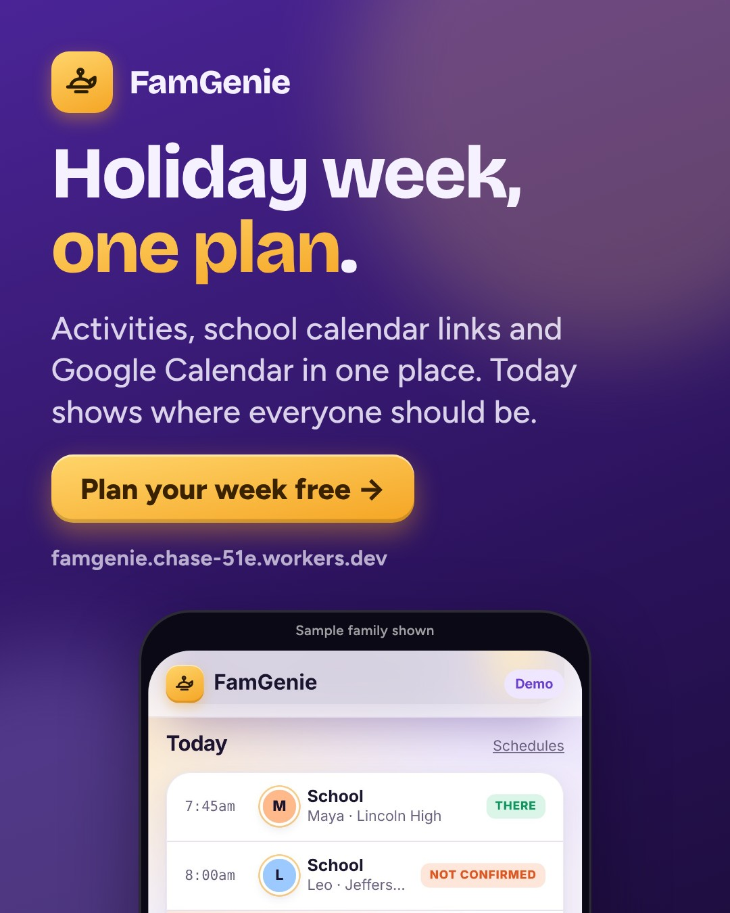
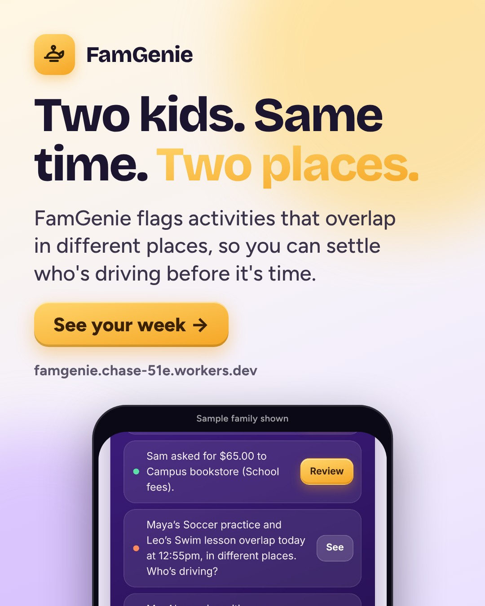
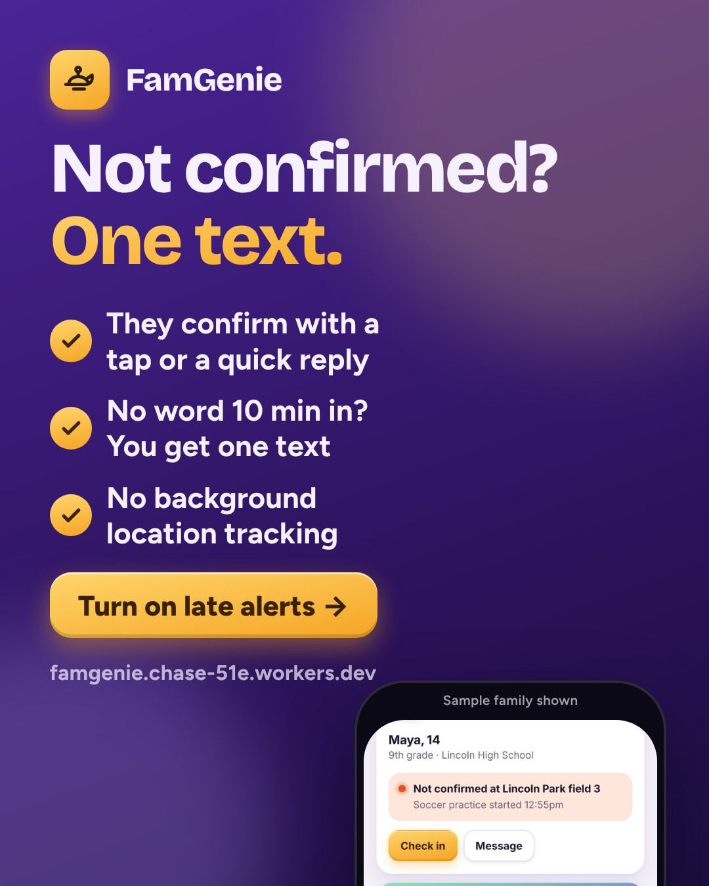
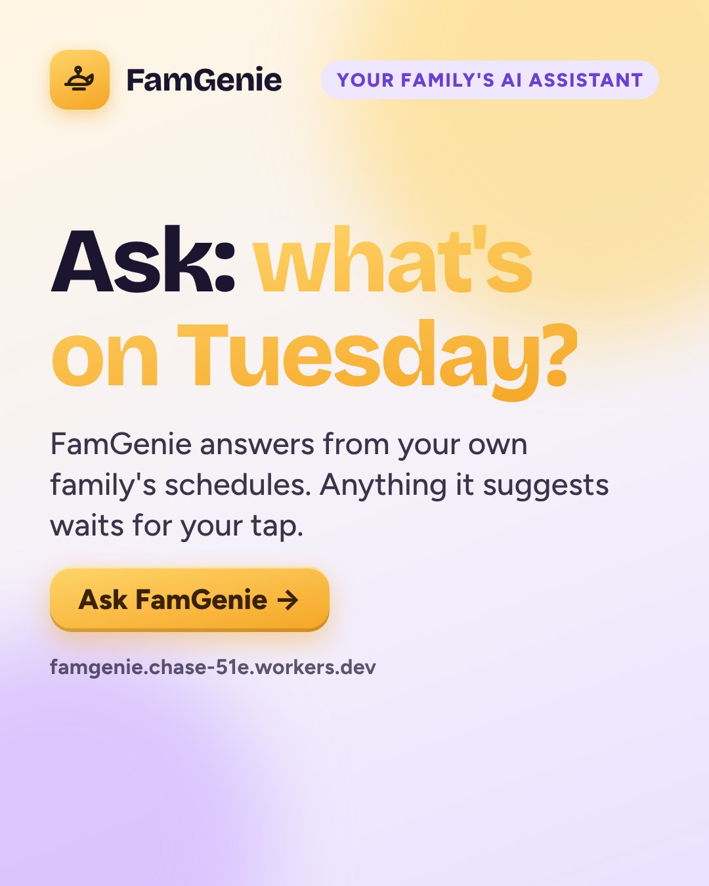
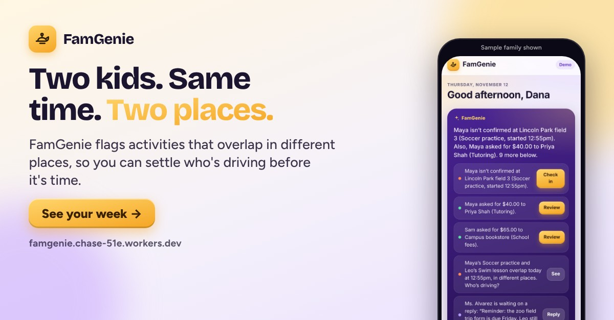
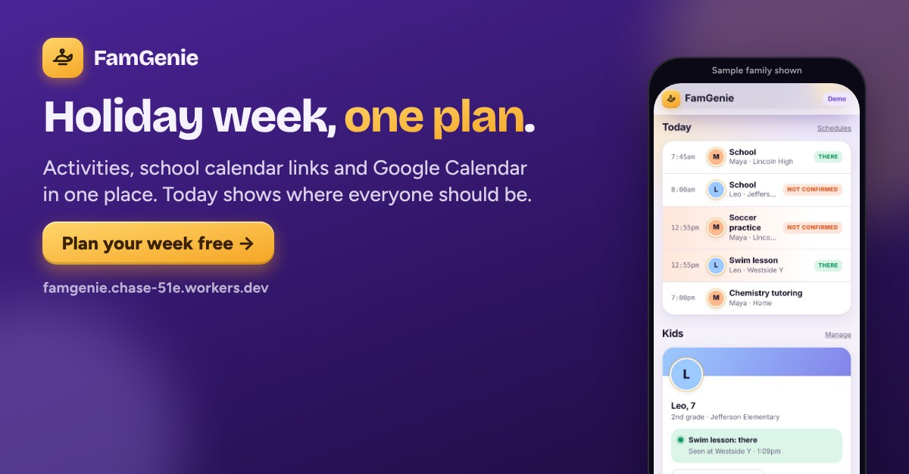
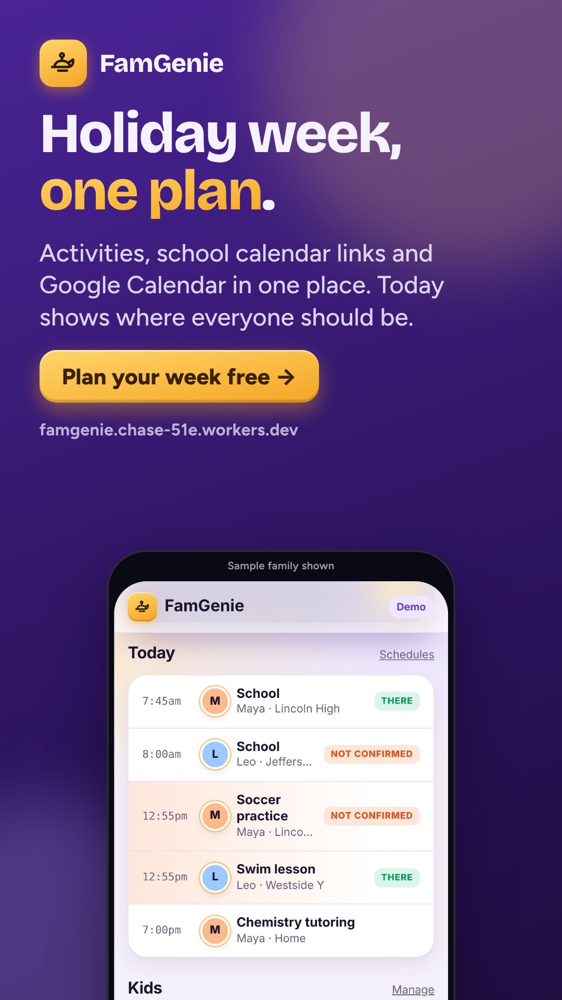

# FamGenie · week of 2026-11-16 · Holiday week, one plan

**Approve by merging this pull request.** Facebook and Instagram posts then go out at their times. Everything else is a ready-to-paste draft.
To change something, edit `marketing/campaigns/2026-11-16.json` and rebuild, or set `"skip": true` on a post. Delete a post to drop it.

**Goal:** Sign-ups from this week's tracked links, and which schedule message (one family plan, two-places-at-once conflicts, or one late text) gets the most clicks per channel.
**Why this angle:** Thanksgiving is Thursday Nov 26, so this is the run-up week: half days, days off, extra practices and travel all land on the calendar at once. Last week (Meet FamGenie, not yet posted, so no results) led with check-ins, the inbox, kids' money and the brief; this week rotates to features that already ship but haven't been the lead: schedules from school/team calendar links and Google Calendar, conflict flags when two kids need to be in different places, late alerts by text, and Ask FamGenie. No results.md exists, so nothing is claimed about past performance.

## facebook · Mon, Nov 16, 7:30 PM · auto after approval



```text
The week before Thanksgiving is when every calendar fills up at once: a half day here, a day off there, an extra practice, a school concert.

FamGenie puts it all in one plan for each kid. Add their weekly activities, paste the school or team calendar link (most offer one under "Subscribe" or "Add to calendar"), or connect Google Calendar. Then the Today view shows where everyone should be.

Free to start. https://famgenie.chase-51e.workers.dev/?utm_source=facebook&utm_medium=social&utm_campaign=2026-11-16-holiday-week-one-plan&utm_content=fb-holiday-plan
```

_Posts automatically at the time shown after this is approved (merged)._

## facebook · Wed, Nov 18, 12:15 PM · auto after approval



```text
Wednesday, 4:30. One kid at swim across town, the other at a rehearsal on the opposite side. Who's driving?

FamGenie looks at your kids' schedules and flags when two activities overlap in different places, so you sort out the carpool on Sunday night instead of in the car.

https://famgenie.chase-51e.workers.dev/?utm_source=facebook&utm_medium=social&utm_campaign=2026-11-16-holiday-week-one-plan&utm_content=fb-two-places
```

_Posts automatically at the time shown after this is approved (merged)._

## facebook · Fri, Nov 20, 7:00 PM · auto after approval



```text
Holiday weeks mean new places and new times, and that's when a pickup gets missed.

With late alerts on, FamGenie texts you once if a child hasn't confirmed 10 minutes after something on their schedule starts. Kids confirm with a tap or a quick reply, so you only hear about it when there's something to check. One text, not a stream of pings.

https://famgenie.chase-51e.workers.dev/?utm_source=facebook&utm_medium=social&utm_campaign=2026-11-16-holiday-week-one-plan&utm_content=fb-one-text
```

_Posts automatically at the time shown after this is approved (merged)._

## instagram · Tue, Nov 17, 7:30 PM · auto after approval


```text
Thanksgiving week calendar check: half days, days off, extra practices, the school concert.

FamGenie gives each kid one plan from their activities, the school or team calendar link, and Google Calendar. Open Today and see where everyone should be.

Free to start. Link in bio.

#thanksgiving #parenting #familycalendar #busyparents #momlife #dadlife
```

_Posts automatically at the time shown after this is approved (merged)._

## instagram · Thu, Nov 19, 8:00 PM · auto after approval


```text
Two kids, two activities, same time, opposite sides of town.

FamGenie spots the overlap in your kids' schedules ahead of time, so the who's-driving conversation happens before the day, not in the parking lot. Link in bio.

#carpool #parenting #momlife #familyorganization #busyparents
```

_Posts automatically at the time shown after this is approved (merged)._

## instagram · Sat, Nov 21, 10:00 AM · auto after approval



```text
Saturday question: what's on Tuesday, and who needs a ride?

Ask FamGenie answers from your own family's schedules and messages. Rules decide what matters, the AI only puts it into words, and anything it suggests waits for your tap. Link in bio.

#parenting #familyplanning #momlife #dadlife #holidayprep
```

_Posts automatically at the time shown after this is approved (merged)._

## linkedin · Tue, Nov 17, 8:30 AM · post by hand



```text
Building FamGenie, an AI assistant for busy parents, taught me that the hardest scheduling problem in a family isn't one person's calendar. It's two kids who need to be in different places at the same time.

So FamGenie builds a "where they should be" plan for each child from three sources: weekly activities a parent types once, school and team calendar links (iCal/webcal), and Google Calendar (read-only). From that it does two things:
- flags overlapping activities in different places, so the carpool gets solved ahead of time
- texts the parent once if a child hasn't confirmed 10 minutes after something starts

The lesson: the useful version is mostly about what not to say. Ordinary school days don't count as conflicts, a late alert goes out once instead of repeating, and the AI only words what the rules already decided needs a parent.

With Thanksgiving week coming, calendars are about to get messy. If you're a parent, it's free to start and I'd value your honest feedback: https://famgenie.chase-51e.workers.dev/?utm_source=linkedin&utm_medium=community&utm_campaign=2026-11-16-holiday-week-one-plan&utm_content=li-calendars

#buildinpublic #parenting
```

_Post by hand from your profile or the company page: paste the text, attach the image._

## reddit · Wed, Nov 18, 11:30 AM · post by hand

**Where:** r/alphaandbetausers

**Title:** Looking for parents to test the schedules part of a family app I made (conflict flags, late texts, school calendar links)



```text
Full disclosure: I made this. FamGenie is a web app for parents of kids 4 to 22, and I'm looking for testers on one part of it before the holiday rush: family schedules.

What I'd like tested:
- Adding a kid's weekly activities, plus a school or team calendar link (iCal/webcal) or Google Calendar (read-only).
- The Today view: does it show where each kid should be, correctly?
- Conflict flags: it should catch two kids with activities in different places at about the same time, and ignore ordinary school days.
- Late alerts: if a kid hasn't confirmed 10 minutes after an activity starts, you get one text. Kids confirm by tapping a link or replying to a text; there's no background location tracking.

If you don't want to sign up, the site opens a labeled demo with a sample family, so you can poke at it first.

What I'm hoping to learn: which calendar links break, whether the conflict rules miss real-life cases, and whether one late text is the right amount. It's free to start: https://famgenie.chase-51e.workers.dev/?utm_source=reddit&utm_medium=community&utm_campaign=2026-11-16-holiday-week-one-plan&utm_content=rd-alphabeta

Happy to answer anything in the comments.
```

_Post by hand. Read the subreddit rules first, post as yourself, reply to every comment, and don’t post the same thing to several subreddits._

## tiktok · Thu, Nov 19, 7:00 PM · post by hand



```text
Thanksgiving week is coming. Here's how I see every kid's schedule in one place, and catch the two-places-at-once problem before Wednesday. #parentsoftiktok #momtok #dadtok #thanksgiving #familyorganization
```

**Script:**

1. 0-2s: on-screen text "Two kids. Same time. Opposite sides of town." over the FamGenie Today view (hook)
2. 2-6s: screen recording, sample family: scroll Today, the two overlapping activities are flagged as a conflict
3. 6-10s: Family tab, Schedules: weekly activities plus a pasted school calendar link
4. 10-13s: Settings: the 'Late alerts by text' toggle, caption: one text if they haven't confirmed 10 min after start
5. 13-15s: end card: one plan for the holiday week. Free to start, link in bio

_Post by hand from the TikTok app: use the video (or record the script), paste the caption._

## group · Sat, Nov 21, 9:30 AM · post by hand

**Where:** A local parents' Facebook group or school PTO page (message the admin first and only post with their OK)

```text
Hi all, with the holiday week coming, a quick tip that's helped us: most school and team websites have a calendar link (look for "Subscribe", "iCal" or "Add to calendar"). Adding it to your own calendar means half days and days off show up without retyping them from the newsletter.

Full disclosure, I built a small app called FamGenie that does this for each kid: activities, the school calendar link and Google Calendar in one plan, a heads-up when two kids need to be in different places at the same time, and one text if a kid hasn't checked in after something starts. The admins said it was OK to share. It's free to start, and I'd really like honest feedback from other parents: https://famgenie.chase-51e.workers.dev/?utm_source=group&utm_medium=community&utm_campaign=2026-11-16-holiday-week-one-plan&utm_content=grp-pto
```

_Ask the group admin first, then post as yourself. Never in groups that ban promotion._

## Videos (Reels, TikTok, Shorts)

- [video/holiday-tour.mp4](video/holiday-tour.mp4)
