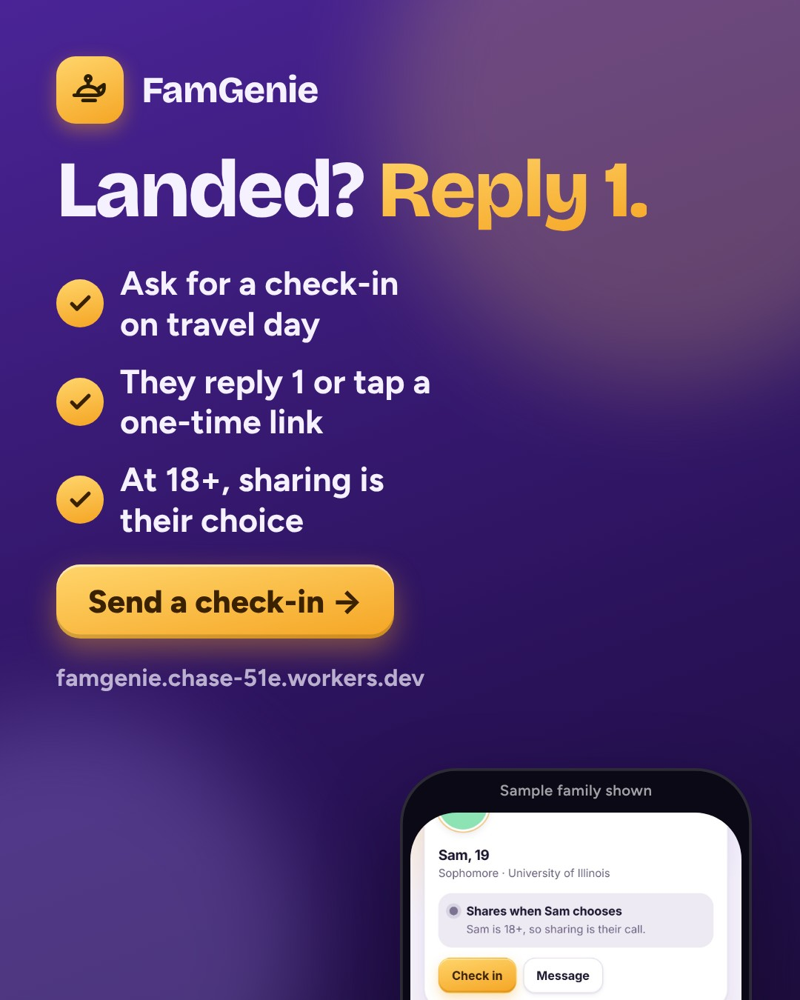
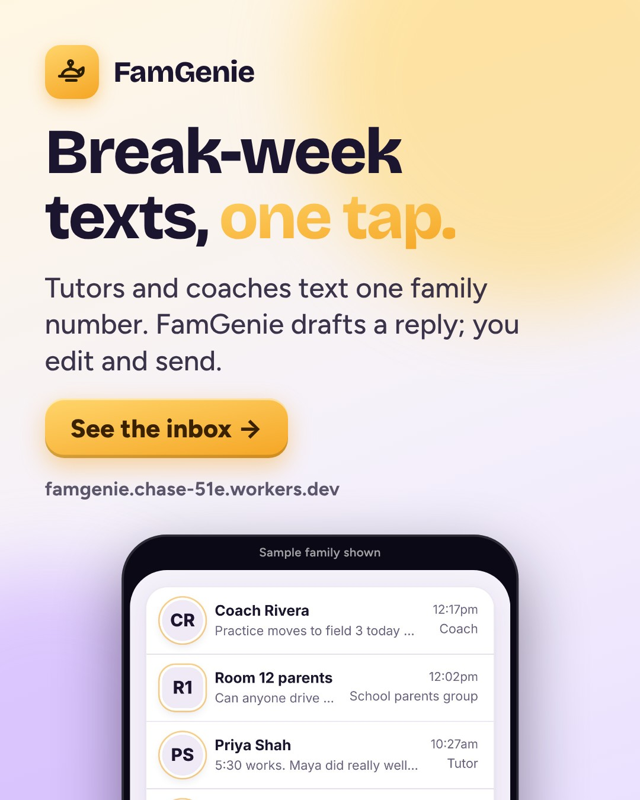
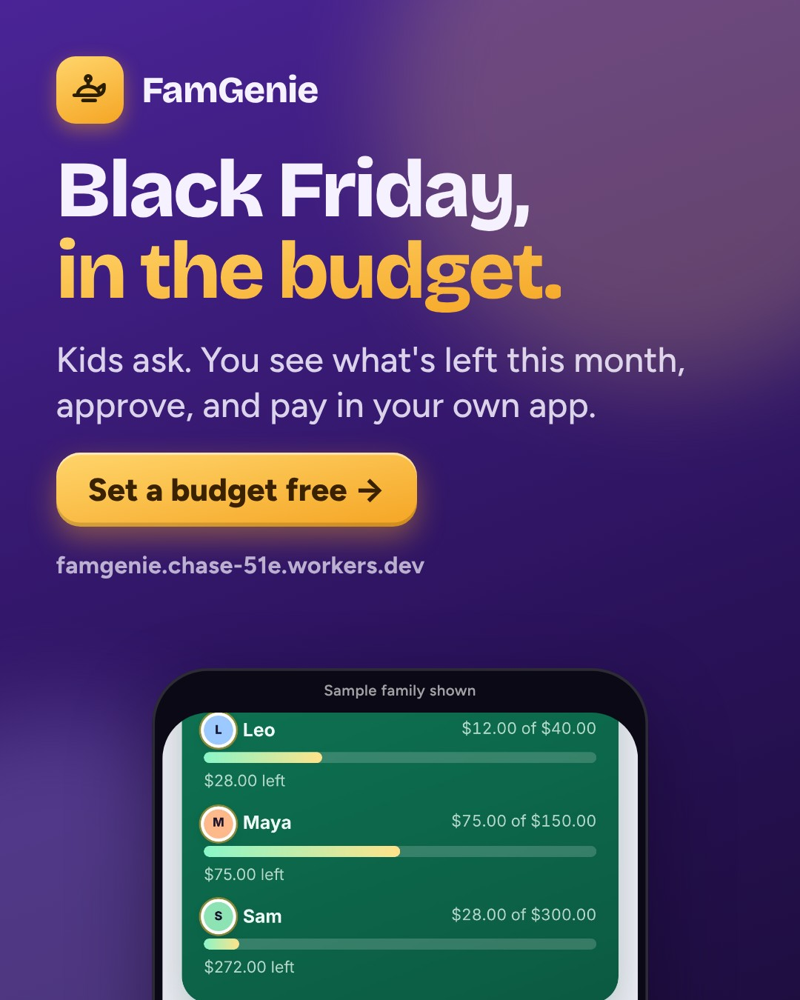
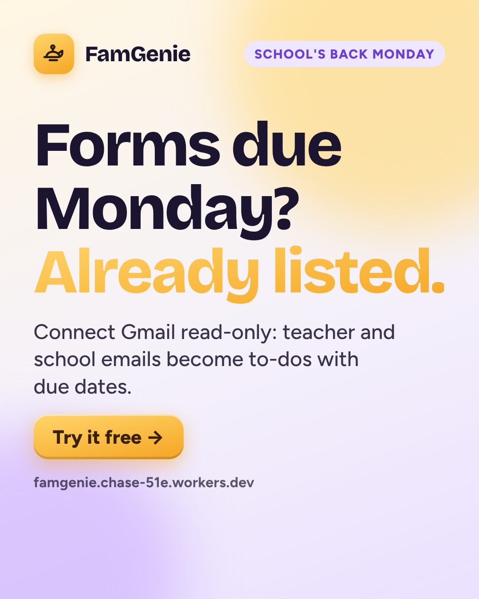
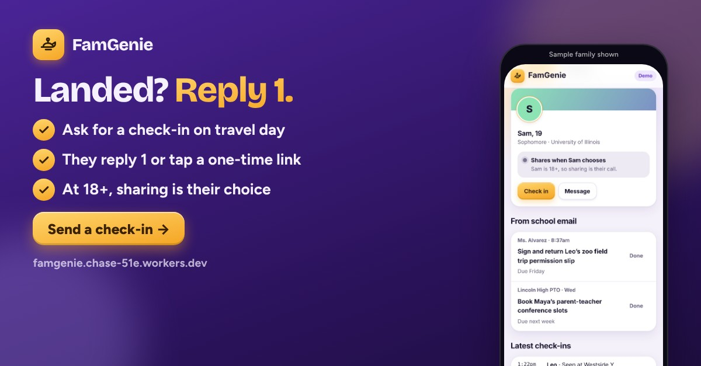
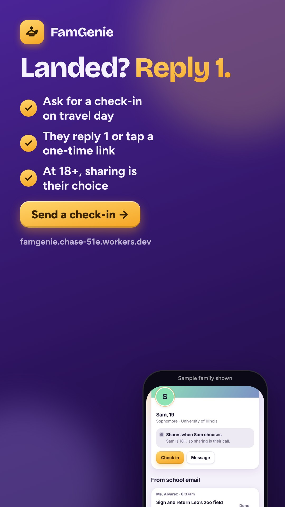
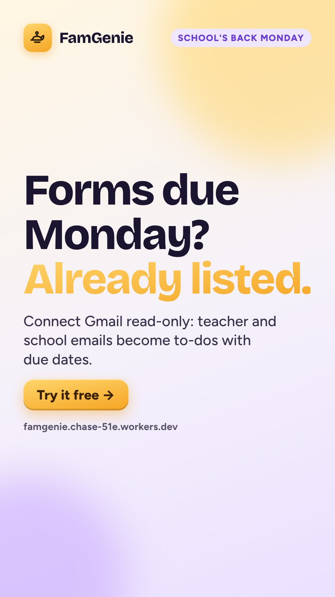

# FamGenie · week of 2026-11-23 · Home for the break

**Approve by merging this pull request.** Facebook and Instagram posts then go out at their times. Everything else is a ready-to-paste draft.
To change something, edit `marketing/campaigns/2026-11-23.json` and rebuild, or set `"skip": true` on a post. Delete a post to drop it.

**Goal:** Sign-ups from this week's tracked links (utm_campaign 2026-11-23-home-for-the-break), and which angle gets the most clicks per channel: travel-day check-ins for kids coming home, drafted replies to tutors and coaches about break schedules, Black Friday requests against a monthly budget, or school emails turned into to-dos before Monday.
**Why this angle:** Thanksgiving is Thursday Nov 26 and Black Friday is Nov 27. College students (18 to 22) travel home this week, tutors and coaches text about skipped or moved sessions, kids ask for Black Friday money, and school restarts Monday Nov 30 with forms and notes that arrived over the break. Every angle is a feature that already ships but hasn't led a week: check-ins that 18+ kids choose to answer (a one-time link or reply 1), one-tap drafted replies in the inbox, the monthly budget meter and the 'after this' line on a money request, and Gmail (read-only) school emails becoming to-dos. Earlier weeks (Meet FamGenie; Holiday week, one plan) led with arrive, inbox, money, brief, schedules, conflicts, late alerts and Ask, and neither has been posted yet. No results.md exists, so nothing is claimed about past performance.

## facebook · Mon, Nov 23, 7:30 PM · auto after approval



```text
This is the week the college kids come home. Flights, buses, long drives, and a parent refreshing the airline app.

In FamGenie you can send your young adult a check-in on travel day: they tap a one-time link or reply 1 when they've landed. At 18 and up, sharing is their choice. FamGenie asks; they decide whether to answer.

It also works for the younger ones heading to a cousin's or a friend's for the long weekend.

Free to start. https://famgenie.chase-51e.workers.dev/?utm_source=facebook&utm_medium=social&utm_campaign=2026-11-23-home-for-the-break&utm_content=fb-home-break
```

_Posts automatically at the time shown after this is approved (merged)._

## facebook · Wed, Nov 25, 12:15 PM · auto after approval



```text
"Are we still on for next Tuesday?" Break weeks bring a lot of these: the tutor, the piano teacher, the coach, the sitter.

In FamGenie they all text one family number and land in one inbox. Tap the sparkle and FamGenie drafts a reply for you. You read it, change what you like, and send. Nothing goes out without your tap.

One less thing to type between pie and the grocery run. https://famgenie.chase-51e.workers.dev/?utm_source=facebook&utm_medium=social&utm_campaign=2026-11-23-home-for-the-break&utm_content=fb-break-replies
```

_Posts automatically at the time shown after this is approved (merged)._

## facebook · Fri, Nov 27, 7:00 PM · auto after approval



```text
Black Friday, from the parent side: "Can I get $60 for the sale?"

When a kid asks in FamGenie, the request shows how much of their monthly budget is left after it, so you can say yes or not this month with the full picture. If you approve, you pay in your own Venmo, PayPal, Cash App, Zelle, their card app or cash. FamGenie never holds or moves money.

A per-category tally shows where the month went, too.

Free to start. https://famgenie.chase-51e.workers.dev/?utm_source=facebook&utm_medium=social&utm_campaign=2026-11-23-home-for-the-break&utm_content=fb-budget
```

_Posts automatically at the time shown after this is approved (merged)._

## instagram · Tue, Nov 24, 7:30 PM · auto after approval


```text
Travel day for the college crew.

Send a check-in from FamGenie: they tap a one-time link or reply 1 when they land. At 18+, sharing is their call. You ask, they answer if they want to.

Free to start. Link in bio.

#thanksgiving #collegekids #homeforthebreak #parenting #momlife #dadlife
```

_Posts automatically at the time shown after this is approved (merged)._

## instagram · Fri, Nov 27, 12:30 PM · auto after approval


```text
"Can I get money for the Black Friday sale?"

In FamGenie, a kid's request shows what's left of their monthly budget after it. You approve, then pay in your own app. FamGenie never holds or moves money. Link in bio.

#blackfriday #kidsandmoney #moneytalks #parenting #momlife #familybudget
```

_Posts automatically at the time shown after this is approved (merged)._

## instagram · Sun, Nov 29, 7:30 PM · auto after approval



```text
Sunday night, school tomorrow. Was there a form?

Connect Gmail (read-only) and FamGenie turns emails from teachers and the school, like forms, field trips and conferences, into to-dos with due dates. Disconnect any time. Link in bio.

#backtoschool #sundayreset #parenting #momlife #dadlife #schoolmom
```

_Posts automatically at the time shown after this is approved (merged)._

## linkedin · Tue, Nov 24, 12:00 PM · post by hand



```text
A design decision in FamGenie, the family assistant I'm building, that I keep coming back to this week: what changes the day a kid turns 18?

FamGenie covers kids from 4 to 22, so it has to handle a first grader and a college junior in the same family. For the younger ones, a parent picks which check-in options fit their age and phone. At 18+, the app changes its own wording and behavior: sharing becomes the young adult's choice. FamGenie can send a one-time check-in link (it works once and expires in 15 minutes) or a "reply 1 or 2" text, and it's up to them to answer. Nothing runs in the background.

The lesson: respect is a feature. A parent of a 20-year-old flying home for Thanksgiving doesn't want surveillance, they want an easy way to ask "landed?" and an easy way for their kid to answer.

If you're a parent with someone coming home this week, it's free to start and I'd value honest feedback: https://famgenie.chase-51e.workers.dev/?utm_source=linkedin&utm_medium=community&utm_campaign=2026-11-23-home-for-the-break&utm_content=li-eighteen

#buildinpublic #parenting
```

_Post by hand from your profile or the company page: paste the text, attach the image._

## reddit · Sat, Nov 28, 11:00 AM · post by hand

**Where:** r/webdev (Showoff Saturday thread/flair, Saturday only)

**Title:** Showoff Saturday: I built a family assistant on one Cloudflare Worker + D1, with no framework or build step


```text
Disclosure: I made this. FamGenie is a web app for parents (kids 4 to 22): check-ins, one inbox for tutors and coaches, kids' money requests a parent approves, schedules, and an AI morning brief. Sharing it here for the build, not the pitch.

How it's put together:
- One Cloudflare Worker serves the static app and routes the API. Handlers use the Pages Functions shape (onRequestGet etc.), so the same code also runs as Pages.
- D1 (SQLite). No migration files: tables are created in code on first use. Plain JS, no framework, no build step. One shared.js file is used by both the browser and the server (place matching, money math, phone formatting).
- Check-in links are random server-issued tokens, stored hashed, single use, and expire in 15 minutes. Location readings are deleted after 30 days.
- Twilio webhooks are signature-checked. Kids can text "PAY 40 Priya tutoring" and the parent gets a request; the app never holds or moves money, it just opens the parent's own payment app with the amount filled in.
- A cron every 10 minutes handles late alerts and calendar refreshes (iCal/webcal links and read-only Google Calendar).
- The AI only words things. Rules decide what needs a parent, message text is passed as data, and no phone numbers or locations go to the model.

Without accounts it opens a labeled demo with a sample family, so you can click around without signing up: https://famgenie.chase-51e.workers.dev/?utm_source=reddit&utm_medium=community&utm_campaign=2026-11-23-home-for-the-break&utm_content=rd-webdev-showoff

Happy to go into any of it: the no-build setup, D1 without migrations, or the token design. Critique welcome.
```

_Post by hand. Read the subreddit rules first, post as yourself, reply to every comment, and don’t post the same thing to several subreddits._

## tiktok · Tue, Nov 24, 7:00 PM · post by hand



```text
My college kid flies home this week. Here's how I ask "landed?" without hovering. At 18+ it's their choice to answer. #parentsoftiktok #collegekids #thanksgiving #momtok #dadtok
```

**Script:**

1. 0-2s: on-screen text "Landed? Reply 1." over the FamGenie Kids section (hook)
2. 2-6s: screen recording, sample family: open the college-age kid's card, it reads "Shares when they choose" (18+)
3. 6-10s: tap Check in, choose the reply 1 or 2 text; show the message they'd get
4. 10-13s: tap Reply "1" in the demo; Home updates to show they made it
5. 13-15s: end card: you ask, they answer. Free to start, link in bio

_Post by hand from the TikTok app: use the video (or record the script), paste the caption._

## tiktok · Sun, Nov 29, 6:30 PM · post by hand



```text
Sunday night after Thanksgiving: the 2-minute reset before school tomorrow. Forms, the tutor, the month's budget. #sundayreset #parentsoftiktok #momtok #backtoschool #familyorganization
```

**Script:**

1. 0-2s: on-screen text "School tomorrow. Was there a form?" over the Home brief (hook)
2. 2-6s: screen recording, sample family: the Home brief lists the school-email to-dos (permission slip due Friday, conference sign-up)
3. 6-10s: Inbox: open the tutor's text, tap the sparkle, a drafted reply appears; edit a word and send
4. 10-13s: Money tab: each kid's monthly budget meter and what's left
5. 13-15s: end card: Sunday reset, done. Free to start, link in bio

_Post by hand from the TikTok app: use the video (or record the script), paste the caption._

## group · Sun, Nov 29, 12:00 PM · post by hand

**Where:** A local parents' Facebook group or school PTO page (message the admin first and only post with their OK)

```text
Hi all, a quick tip before school starts back tomorrow: search your email for the school's domain plus "form", "permission" or "due" from the last week. That's how we found a field-trip slip that came out the day before break.

Full disclosure, I made a small app called FamGenie that does this part for us: with Gmail connected (read-only), emails from teachers and the school become to-dos with due dates, next to each kid's schedule and the tutor and coach texts. I asked the admins first and they said it was OK to share. It's free to start, and I'd really like honest feedback from other parents: https://famgenie.chase-51e.workers.dev/?utm_source=group&utm_medium=community&utm_campaign=2026-11-23-home-for-the-break&utm_content=grp-pto-monday
```

_Ask the group admin first, then post as yourself. Never in groups that ban promotion._

## Videos (Reels, TikTok, Shorts)

- [video/home-break-tour.mp4](video/home-break-tour.mp4)
- [video/sunday-reset.mp4](video/sunday-reset.mp4)
