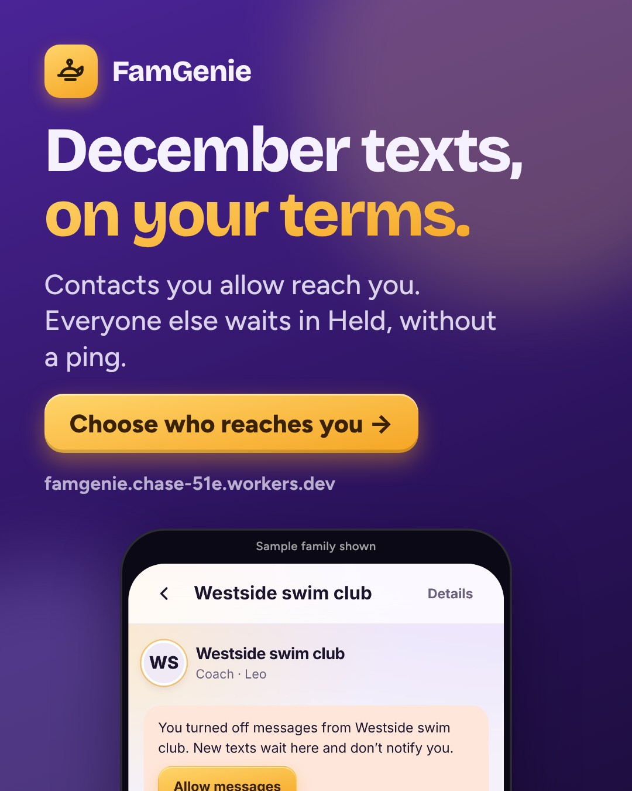
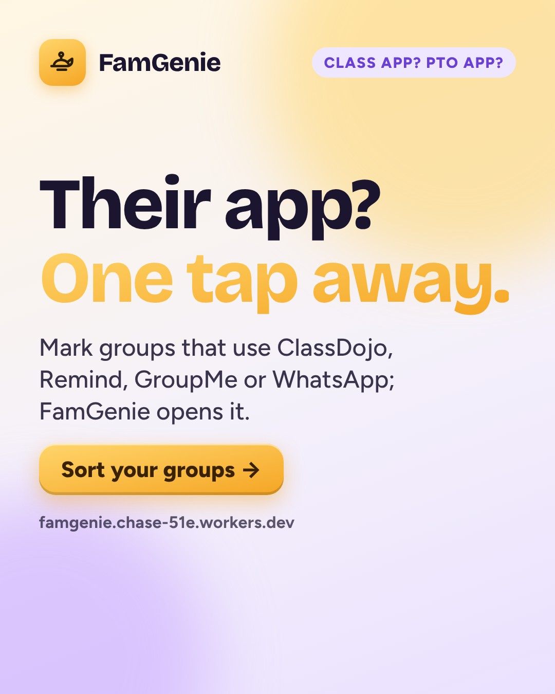
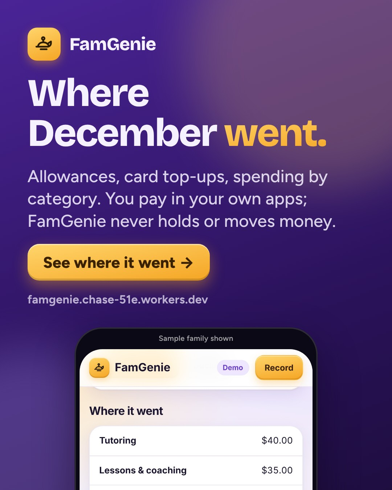
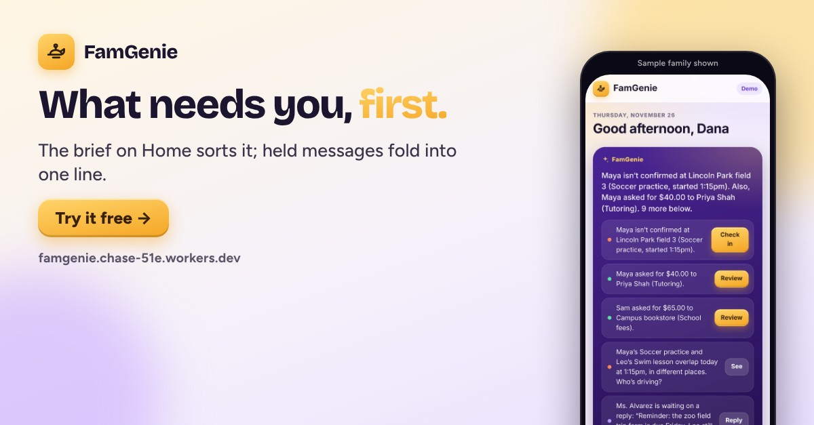
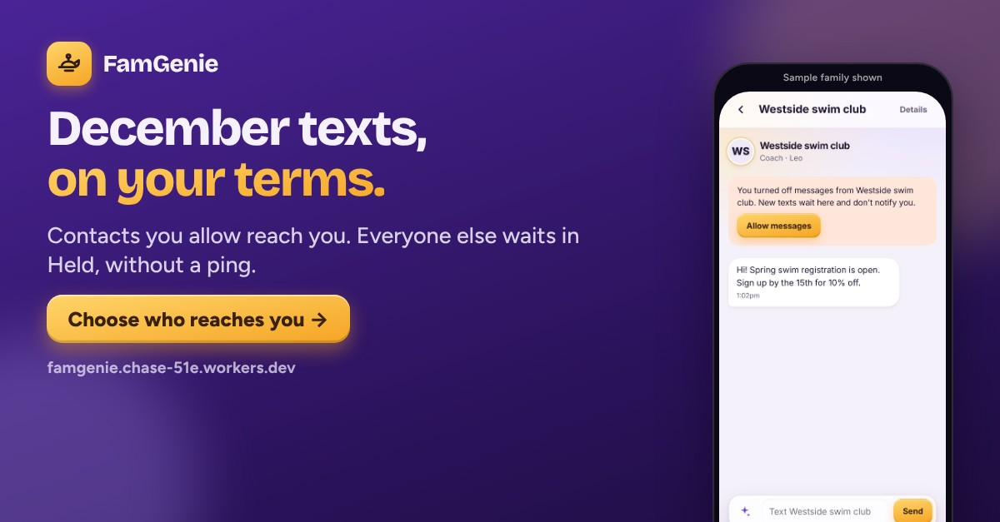
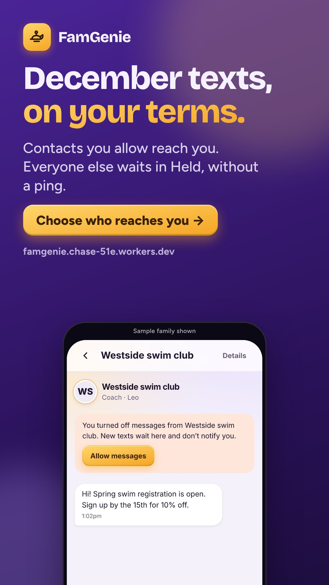
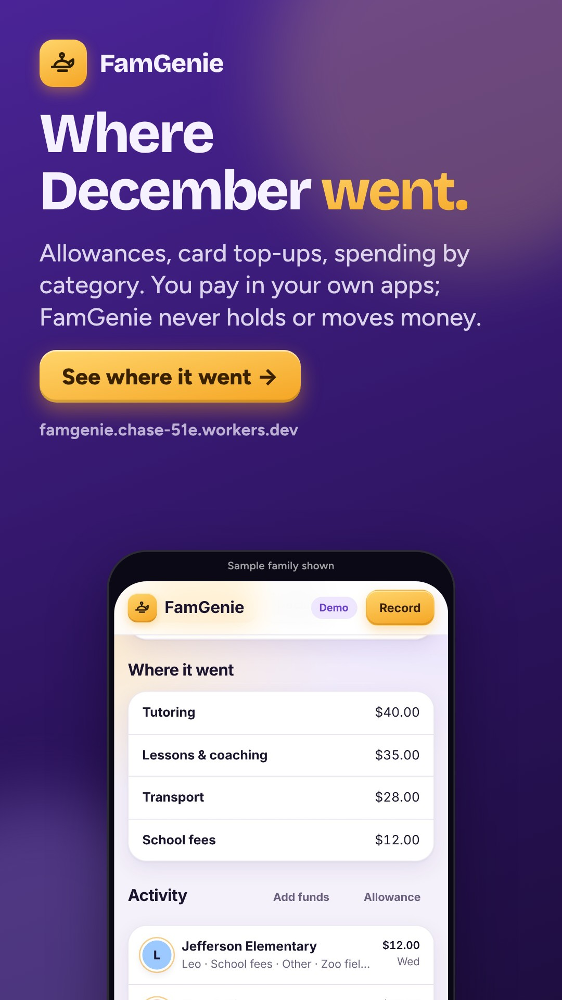

# FamGenie · week of 2026-11-30 · A quieter December

**Approve by merging this pull request.** Facebook and Instagram posts then go out at their times. Everything else is a ready-to-paste draft.
To change something, edit `marketing/campaigns/2026-11-30.json` and rebuild, or set `"skip": true` on a post. Delete a post to drop it.

**Goal:** Sign-ups from this week's tracked links (utm_campaign 2026-11-30-a-quieter-december), compared by utm_content to see which angle brings the most: choosing who can reach you (Held), groups that stay on their own app, or the gift-season money tally.
**Why this angle:** School restarts Monday Nov 30 after Thanksgiving, and December stacks up fast: winter concerts, class parties, teacher-gift collections, end-of-season team messages, sign-up promos, and kids asking for gift money. Every angle this week ships today and has never led a week: contacts you haven't allowed (and numbers not in your contacts) wait in Held without notifying you; groups that only use ClassDojo, Remind, GroupMe or WhatsApp can be marked so FamGenie opens that app instead; allowances, card top-ups and the per-category 'Where it went' tally (including a Gifts category) with money paid in the parent's own apps, never held or moved by FamGenie; and the brief on Home that sorts what needs you first and folds held messages into one line. Earlier weeks (Meet FamGenie; Holiday week, one plan; Home for the break) led with check-ins, the inbox in general, money requests, schedules, conflicts, late alerts, Ask, 18+ check-ins, drafted replies, the budget meter and Gmail to-dos. None of those PRs is merged and nothing has been posted; there is no results.md, so nothing is claimed about past performance.

## facebook · Mon, Nov 30, 7:30 PM · auto after approval



```text
First week back after Thanksgiving, and the December texts have already started: concert call times, party sign-ups, the team photo order, and a few "register now and save" messages you never asked for.

In FamGenie you choose who can reach you. Tutors, teachers and coaches you've allowed land in your inbox. Anyone you've turned off, and any number that isn't in your contacts, waits in a Held tab and doesn't notify you. Look when you have a minute, and allow or add them with one tap.

Free to start. https://famgenie.chase-51e.workers.dev/?utm_source=facebook&utm_medium=social&utm_campaign=2026-11-30-a-quieter-december&utm_content=fb-held
```

_Posts automatically at the time shown after this is approved (merged)._

## facebook · Wed, Dec 2, 12:15 PM · auto after approval



```text
Not every group is going to switch apps for you. The class uses one app, the PTO lives in WhatsApp, the team uses GroupMe.

FamGenie doesn't pretend otherwise. When you add a group, pick "They use ClassDojo" (or Remind, GroupMe, WhatsApp, Seesaw, ParentSquare). It's labeled External in your contacts, and opening it in FamGenie gives you a button straight to their app, so you know where each conversation lives. Everyone else texts one family number and lands in one inbox.

One list of who's who, even when the chats are in different places. https://famgenie.chase-51e.workers.dev/?utm_source=facebook&utm_medium=social&utm_campaign=2026-11-30-a-quieter-december&utm_content=fb-group-apps
```

_Posts automatically at the time shown after this is approved (merged)._

## facebook · Fri, Dec 4, 7:00 PM · auto after approval



```text
December money, from the parent side: the teacher-gift collection, the class party, the gift exchange, a December allowance, and "can you put $20 on my card?"

In FamGenie you record allowances and card top-ups per kid, and every payment gets a category. The Money tab shows the month's spending and a "Where it went" list by category, Gifts included, so January isn't a surprise.

FamGenie never holds or moves money. You pay in your own Venmo, Zelle, PayPal, Cash App, your kid's card app or cash, and it keeps the tally.

Free to start. https://famgenie.chase-51e.workers.dev/?utm_source=facebook&utm_medium=social&utm_campaign=2026-11-30-a-quieter-december&utm_content=fb-gift-tally
```

_Posts automatically at the time shown after this is approved (merged)._

## instagram · Tue, Dec 1, 7:30 PM · auto after approval


```text
December inbox, on your terms.

In FamGenie, the tutor, the teacher and the coach reach you. Numbers you haven't allowed wait in Held, quietly, until you look. Allow or add them with one tap.

Free to start. Link in bio.

#december #parenting #momlife #dadlife #schoolmom #familyorganization
```

_Posts automatically at the time shown after this is approved (merged)._

## instagram · Thu, Dec 3, 7:30 PM · auto after approval


```text
The class uses one app. The PTO uses another. The team uses a third.

In FamGenie, mark a group as using its own app and it gets an Open button that takes you there. Everyone else texts one family number. One list of who's who. Link in bio.

#ptomom #schoolparents #parenting #momlife #dadlife #familyorganization
```

_Posts automatically at the time shown after this is approved (merged)._

## instagram · Sat, Dec 5, 12:30 PM · auto after approval


```text
Teacher gifts, class party, gift exchange, December allowance.

FamGenie keeps a per-kid tally of allowances, card top-ups and payments by category, so you can see where December went. You pay in your own apps; FamGenie never holds or moves money. Link in bio.

#holidaybudget #kidsandmoney #allowance #parenting #momlife #familybudget
```

_Posts automatically at the time shown after this is approved (merged)._

## linkedin · Tue, Dec 1, 12:00 PM · post by hand



```text
A lesson from building FamGenie, the family assistant I'm working on: the most useful inbox feature isn't a smarter inbox, it's deciding who gets in.

FamGenie gives a family one number for tutors, teachers and coaches. Early on I treated every incoming text the same. That's fine until December, when a parent hears from every activity at once, plus sign-up promos and numbers they don't recognize.

So parents choose who can reach them. Contacts they've allowed land in the inbox. Anyone they've turned off, and any number that isn't a contact, waits in a Held tab with no notification. The brief on Home rolls all of that into one line instead of a list.

The second lesson was humility: some groups will only ever use their own app. Rather than fight that, a parent can mark a group as using ClassDojo, Remind, GroupMe or WhatsApp, and FamGenie opens that app for them.

It's free to start, and I'd value honest feedback from parents: https://famgenie.chase-51e.workers.dev/?utm_source=linkedin&utm_medium=community&utm_campaign=2026-11-30-a-quieter-december&utm_content=li-who-can-reach

#buildinpublic #parenting
```

_Post by hand from your profile or the company page: paste the text, attach the image._

## reddit · Wed, Dec 2, 12:00 PM · post by hand

**Where:** r/IMadeThis (verify rules before posting)

**Title:** I made a family inbox where unknown numbers wait in a Held tab, and groups that live on other apps just get an Open button



```text
Disclosure: I made this. FamGenie is a web app for parents of kids 4 to 22. This post is about one part of it: the inbox, and two decisions I made after watching how December goes for a parent.

1. You choose who can reach you. Tutors, teachers, coaches and sitters text one family number. Contacts you've allowed land in the inbox. Contacts you've turned off, and numbers that aren't in your contacts, wait in a Held tab and don't notify you. Each held thread has one button: Allow messages, or Add as contact. The brief on Home sums held messages up in one line instead of listing them.

2. I stopped trying to replace every group chat. Some classes only use ClassDojo, some PTOs only use WhatsApp, some teams only use GroupMe. When you add a group you can pick "They use ..." and FamGenie shows an Open button for that app instead of a composer that nobody on the other end would read.

Without an account it opens a labeled demo with a sample family, so you can try both in the Inbox tab without signing up: https://famgenie.chase-51e.workers.dev/?utm_source=reddit&utm_medium=community&utm_campaign=2026-11-30-a-quieter-december&utm_content=rd-imadethis

I'd like critique on the Held idea in particular. Is "not in your contacts means held" too strict for a parent, or not strict enough?
```

_Post by hand. Read the subreddit rules first, post as yourself, reply to every comment, and don’t post the same thing to several subreddits._

## tiktok · Tue, Dec 1, 7:00 PM · post by hand



```text
December texts are starting. Here's how I decide who can actually reach me, and what happens to everyone else. #parentsoftiktok #momtok #dadtok #december #familyorganization
```

**Script:**

1. 0-2s: on-screen text "December texts, on your terms" over the held Westside swim club thread (hook)
2. 2-6s: screen recording, sample family: the brief on Home lists what needs you first; tap Inbox, then the Held (1) tab
3. 6-9s: Westside swim club's sign-up promo is waiting in Held, no notification; open it and show the "Allow messages" button
4. 9-12s: Family tab: Lincoln High PTO is marked External; open it and show "Where you talk: They use WhatsApp"
5. 12-15s: end card: you choose who reaches you. Free to start, link in bio

_Post by hand from the TikTok app: use the video (or record the script), paste the caption._

## tiktok · Sun, Dec 6, 6:30 PM · post by hand



```text
Sunday money check before the December rush: allowances, card top-ups, and where it all went. I pay in my own apps; this just keeps the tally. #parentsoftiktok #kidsandmoney #allowance #momtok #holidaybudget
```

**Script:**

1. 0-2s: on-screen text "Where did December's money go?" over the Money tab (hook)
2. 2-6s: screen recording, sample family: the month's spending, each kid's line, and "added to cards and allowances"
3. 6-10s: tap Allowance: the sheet switches between Payment, Card top-up and Allowance; pick a kid and an amount
4. 10-13s: scroll to "Where it went": spending by category for the month
5. 13-15s: end card: you pay in your own apps; FamGenie never holds or moves money. Free to start, link in bio

_Post by hand from the TikTok app: use the video (or record the script), paste the caption._

## group · Thu, Dec 3, 12:00 PM · post by hand

**Where:** A local parents' Facebook group or school PTO page (message the admin first and only post with their OK)

```text
Hi all, a small December tip that has made our phones calmer: make a note of which app each group actually uses (class, PTO, team, choir) and who the real contact is for each. When the concert call time changes, you know where to look, and anything from a number you don't recognize can wait.

Full disclosure, I made a small app called FamGenie that does this for our family: tutors, teachers and coaches text one number, anyone we haven't allowed waits in a Held tab without notifying us, and groups that only use their own app get a button that opens it. I asked the admins first and they said it was OK to share. It's free to start, and I'd really like honest feedback from other parents: https://famgenie.chase-51e.workers.dev/?utm_source=group&utm_medium=community&utm_campaign=2026-11-30-a-quieter-december&utm_content=grp-pto-december
```

_Ask the group admin first, then post as yourself. Never in groups that ban promotion._

## Videos (Reels, TikTok, Shorts)

- [video/december-tour.mp4](video/december-tour.mp4)
- [video/gift-money-tour.mp4](video/gift-money-tour.mp4)
